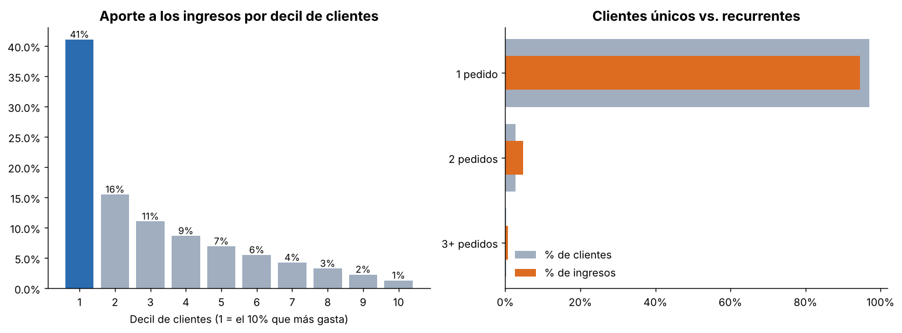
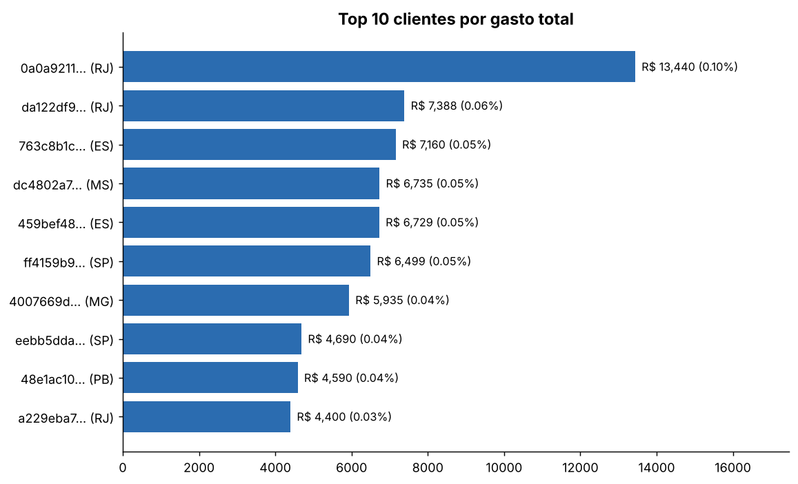
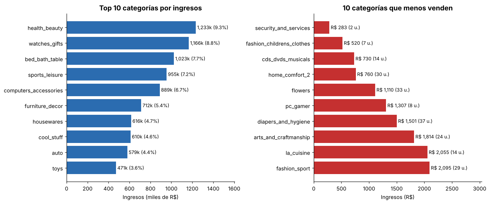
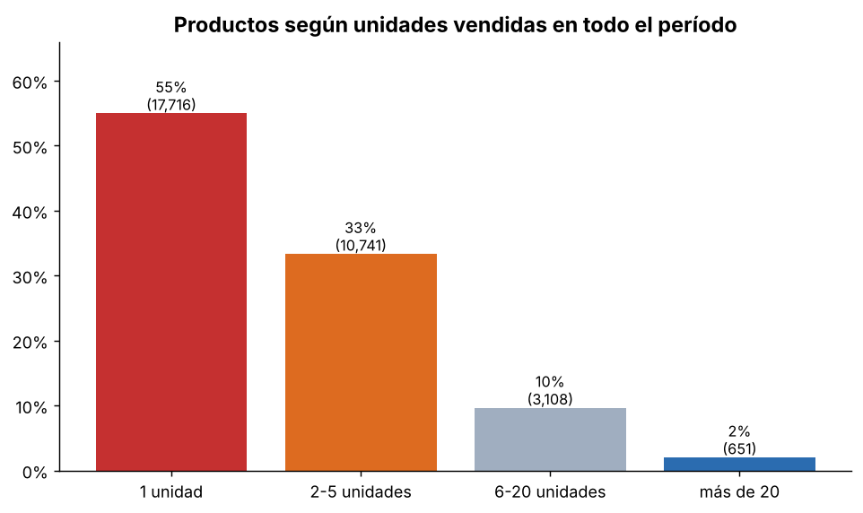
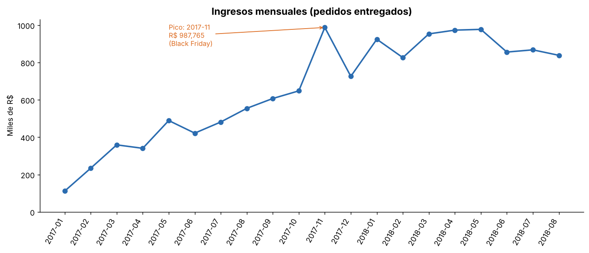
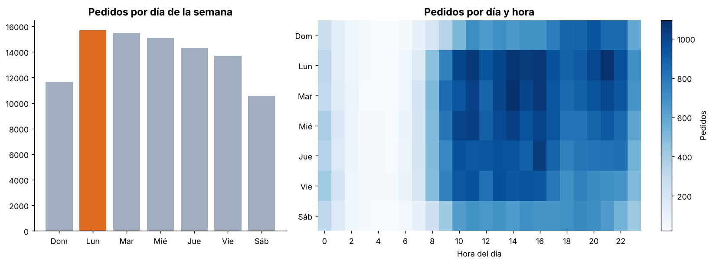
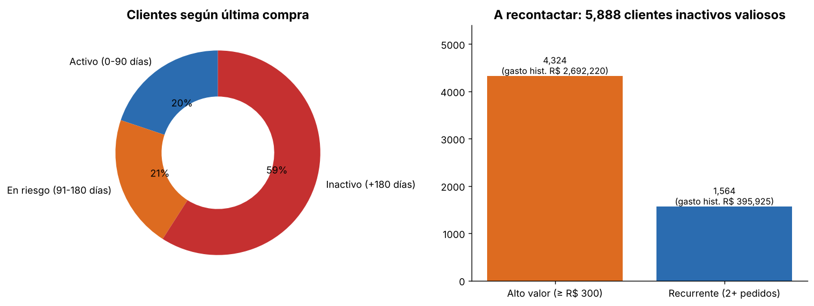

# 🛒 Análisis de ventas e-commerce — Olist (Brasil)

Proyecto de análisis de datos con **Python (pandas)** y **SQL** sobre el dataset público
[Brazilian E-Commerce de Olist](https://www.kaggle.com/datasets/olistbr/brazilian-ecommerce) (Kaggle):
99.441 pedidos realizados entre septiembre de 2016 y octubre de 2018.

**👉 [Ver el dashboard interactivo](https://inaki-fsd.github.io/Analisis-Ventas/)**

El objetivo es responder cuatro preguntas de negocio:

1. ¿Quiénes son los mejores clientes y cuánto aportan al total?
2. ¿Qué productos generan más ingresos y cuáles venden poco?
3. ¿En qué períodos se concentran las ventas?
4. ¿Qué clientes dejaron de comprar y conviene recontactar?

## 🧰 Tecnologías

| Herramienta | Uso |
|---|---|
| **pandas** | Lectura, limpieza (fechas, nulos, traducción de categorías) y carga a la base |
| **SQLite + SQL** | Consultas analíticas: CTEs, funciones de ventana (`NTILE`, `SUM() OVER`), agregaciones |
| **matplotlib** | Gráficos estáticos (PNG) |
| **HTML + Chart.js** | Dashboard interactivo generado desde Python |

## 📁 Estructura

```
Analisis-Ventas/
├── data/raw/              # CSV originales de Kaggle (no se suben al repo)
├── sql/                   # Consultas, una por pregunta de negocio
│   ├── 00_vista_ventas.sql
│   ├── 01_mejores_clientes.sql
│   ├── 02_productos.sql
│   ├── 03_estacionalidad.sql
│   ├── 04_clientes_inactivos.sql
│   └── 05_dashboard.sql
├── dashboard/plantilla.html   # Diseño del dashboard
├── docs/index.html            # Dashboard generado (GitHub Pages)
├── src/
│   ├── 01_load_and_clean.py   # pandas: limpia y crea data/olist.db
│   ├── 02_analisis.py         # ejecuta el SQL, exporta tablas y gráficos
│   └── 03_dashboard.py        # genera el dashboard interactivo
├── outputs/
│   ├── figures/               # Gráficos PNG
│   └── tables/                # Resultados en CSV
└── requirements.txt
```

## ▶️ Cómo ejecutarlo

```bash
pip install -r requirements.txt

# 1. Descargá el dataset de Kaggle y dejá los CSV en data/raw/
# 2. Corré el pipeline
python src/01_load_and_clean.py
python src/02_analisis.py
python src/03_dashboard.py   # crea docs/index.html: abrilo con doble clic
```

## 📐 Criterios del análisis

- **Ingreso** = precio del producto (sin flete), solo de pedidos con estado `delivered`.
- **Cliente** = `customer_unique_id` (el `customer_id` de Olist cambia en cada pedido).
- Total analizado: **R$ 13,2 millones**, **93.358 clientes**, **96.478 pedidos**.
- **Inactivo** = más de 180 días sin comprar, tomando como referencia la última compra del dataset.
- **Conviene recontactar** = inactivo y (2+ pedidos o gasto histórico ≥ R$ 300).

## 🔎 Hallazgos

### 1. Mejores clientes
- Los ingresos están **repartidos**: los 20 mejores clientes aportan solo el 0,8 % del total.
- El **10 % de clientes que más gasta concentra el 41 %** de los ingresos.
- El **97 % compra una sola vez** (y aporta el 94,5 % de los ingresos). Solo el 3 % repite.




### 2. Productos
- Las **5 categorías principales suman el 40 %** de los ingresos: `health_beauty` (9,3 %), `watches_gifts`, `bed_bath_table`, `sports_leisure` y `computers_accessories`.
- Cola larga: `security_and_services` vendió 2 unidades (R$ 283) en todo el período.
- **El 55 % de los productos vendió una sola unidad.**




### 3. Estacionalidad
- Fuerte crecimiento durante 2017 y meseta de ~R$ 850–980 mil por mes en 2018.
- **Noviembre de 2017 es el pico** (R$ 988 mil), explicado por el **Black Friday del 24/11/2017**: 1.147 pedidos y R$ 150 mil en un solo día, más del doble que cualquier otro día del dataset.
- Se compra más de **lunes a miércoles**; los sábados y domingos son los días más flojos. Las horas pico son las **11 h y de 13 a 16 h**.




### 4. Clientes a recontactar
- El **59 % de los clientes lleva más de 180 días sin comprar**.
- Se identificaron **5.888 clientes inactivos valiosos** (1.564 recurrentes y 4.324 de alto valor) que acumulan R$ 3,1 millones de gasto histórico.
- La lista priorizada por gasto está en [`outputs/tables/lista_recontactar_top500.csv`](outputs/tables/lista_recontactar_top500.csv).



## 💡 Recomendaciones

1. **Retención**: con un 97 % de compradores únicos, una campaña de segunda compra tiene más potencial que captar clientes nuevos.
2. **Reactivación**: empezar por los 500 clientes inactivos de mayor valor del archivo exportado.
3. **Calendario comercial**: planificar stock y campañas para Black Friday y concentrar comunicaciones en días de semana.
4. **Catálogo**: revisar los productos de una sola venta y las categorías marginales.

## ⚠️ Limitaciones

- 2016 y desde septiembre de 2018 tienen muy pocos datos, por eso el análisis mensual usa 2017-01 a 2018-08.
- Con solo ~2 años no se puede separar estacionalidad anual de crecimiento del negocio.
- Los umbrales (180 días, R$ 300) son criterios de negocio ajustables en `sql/04_clientes_inactivos.sql`.

## 📄 Datos y licencia

Dataset de Olist publicado en Kaggle bajo licencia CC BY-NC-SA 4.0. No se incluye en este repositorio: descargarlo desde el enlace de arriba.
